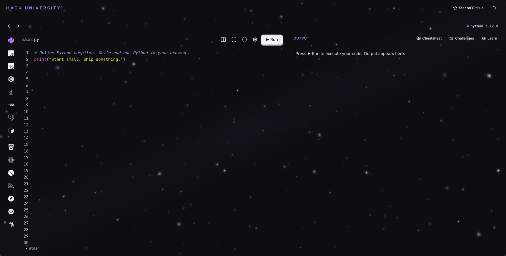
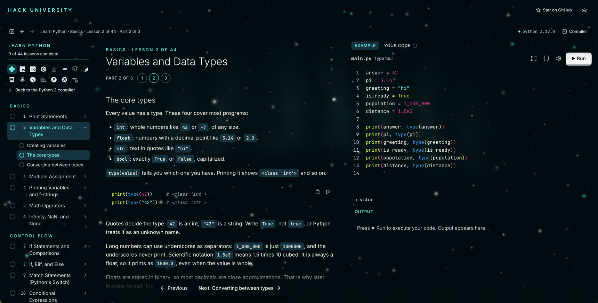

# Hack University Compiler

> The Hack University app: compilers, lessons, and real projects, running
> entirely on your own computer. Free.

If it helps you, please give it a star on GitHub. Stars help other students find
it, and they tell us what to build next.

Write and run **Python, JavaScript, TypeScript, C++, Java, Go, Bash, and SQL**
in the browser, and learn each one with short lessons, cheatsheets, and
challenges that check your answers. The project courses, **HTML, CSS & JS,
React, Next.js, Express, FastAPI, Spring Boot, and Go APIs**, open real
codebases in an IDE with terminals, a live preview, and real databases.

Everything runs on your computer, in Docker. Nothing leaves it.





## What you need

- [Node.js](https://nodejs.org) 24.12 or newer
- [Docker Desktop](https://docs.docker.com/get-docker/) with at least 8 GB of
  memory (Settings → Resources)
- Disk space for what you pick: 1.2 GB for just the app, about 16 GB for
  everything

It runs on a Mac, on Windows 10 or 11, and on Linux:

- **Mac**: on Apple Silicon, turn on **"Use Rosetta for x86_64/amd64
  emulation"** in Docker Desktop's settings, so code runs at full speed.
- **Windows**: Docker Desktop with its WSL 2 backend (the default). Run the
  commands below in PowerShell, or clone and run inside WSL (Ubuntu), where
  the project courses run fastest.
- **Linux**: Docker Engine with the compose plugin, and your user in the
  `docker` group. The project courses need your user id to be 1000, the
  first account on most systems.

## Start

```bash
git clone https://github.com/Valx01P/hack-university-compiler.git
cd hack-university-compiler
npm run up
```

The first time, it shows a checklist of the compilers and courses with each
one's size, the total, and your free disk space. Pick what you want and press
Enter. It installs that and opens the app at
[http://localhost:3000](http://localhost:3000).

After that, `npm run up` starts the app in seconds. Ctrl+C stops it.

## Pick what to install

| Compiler | Size | Project course | Size |
| --- | --- | --- | --- |
| Python | 1.1 GB | HTML, CSS & JS, React, and Next.js | 1.9 GB |
| JavaScript | 215 MB | Express | 3.6 GB |
| C++ | 2.8 GB | FastAPI | 1.4 GB |
| Java | 510 MB | Spring Boot | 1.5 GB |
| Go | 525 MB | Go APIs | 2.7 GB |
| TypeScript | 1.8 GB | | |
| Bash | 545 MB | | |

The app itself (lessons, cheatsheets, SQL, and search) is 1.2 GB and always
comes. Shared parts download once: Python, JavaScript, C++, Java, and Go share
a 1.4 GB sandbox, TypeScript shares its images with the web courses, and the
server courses share PostgreSQL. So the total is often less than the sum, and
the checklist shows the real total as you pick.

Change it any time:

```bash
npm run status              # what's installed, and how much space each takes
npm run add -- cpp spring   # install more
npm run remove -- cpp       # remove some and get the space back
npm run choose              # the checklist again
npm run clean               # clear Docker's leftover build files
```

`add` and `remove` show the size and ask before they change anything. If you
run something that isn't installed, the app tells you the command to add it.
To skip the checklist, use `npm run up -- --all` for everything or
`npm run up -- --minimal` for just the app.

With [Task](https://taskfile.dev) installed, `task`, `task add -- cpp`, and the
rest do the same.

## Troubleshooting

- **"sandbox offline"**: start Docker Desktop, then run `npm run up` again.
- **"isn't installed yet"**: run the `npm run add` command it shows, then
  reload the page.
- **Slow runs on a Mac**: turn on Rosetta in Docker Desktop (see above).
- **Port 3000 or 3100 is taken**: an earlier `npm run up` is probably still
  running, so stop it first. Or use other ports:
  `PORT=3001 HU_RUNNER_PORT=3101 npm run up` (in PowerShell,
  `$env:PORT=3001; $env:HU_RUNNER_PORT=3101; npm run up`).
- **"your user can't reach" Docker** on Linux: run
  `sudo usermod -aG docker $USER`, then sign out and back in.
- **Linux**: the compiler sandbox needs cgroup v2, the default on current
  distributions.

## Learn more

[docs/guide.md](docs/guide.md) has everything else: every feature, the editor's
keys, the themes, how it all works, every script, and how to add a language.

## Credits

- Code execution by [Piston](https://github.com/engineer-man/piston) (MIT).
- SQL by [PGlite](https://github.com/electric-sql/pglite) (Apache 2.0 and the
  PostgreSQL License).
- Animations by [GSAP](https://gsap.com) (free under its standard "no charge"
  license).
- Cheatsheet search by [Model2Vec](https://github.com/MinishLab/model2vec)'s
  [potion-base-8M](https://huggingface.co/minishlab/potion-base-8M) (MIT).
- The Java coffee cup icon is from [Devicon](https://github.com/devicons/devicon)
  (MIT). The other language icons are from [Simple Icons](https://simpleicons.org)
  (CC0).
